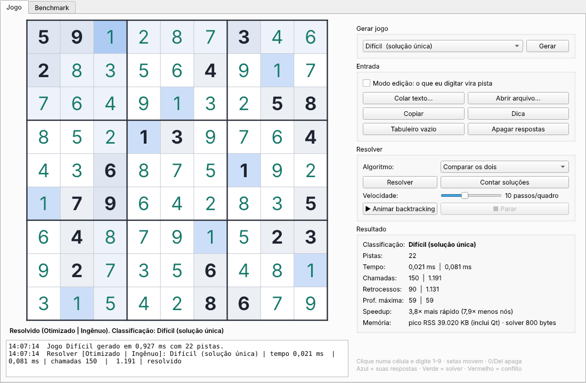

# Sudoku com Backtracking

Prática Avaliativa — Computação de Alto Desempenho (FACAMP)

## Integrantes

| Nome | RA | GitHub |
|---|---|---|
| Henrique Radi    | 202410144 | [@Genbaico](https://github.com/Genbaico) |
| Rafael Rodrigues | 202410262 | [@RafaelRodrigues1003](https://github.com/RafaelRodrigues1003) |

Solver e gerador de Sudoku em **C++17** com dois algoritmos de backtracking: um **padrão (ingênuo)** e um **otimizado** (máscaras de bits + heurística MRV + poda). O projeto tem uma versão de console (realizado pelos autores) e uma versão gráfica em Qt (construido com ajuda de IA - Claude), gera jogos por nível de dificuldade e mede o desempenho dos dois algoritmos.



---

## Sumário

1. [Requisitos do trabalho](#1-requisitos-do-trabalho)
2. [Estrutura do repositório](#2-estrutura-do-repositório)
3. [Como compilar e executar](#3-como-compilar-e-executar)
4. [Estrutura de dados](#4-estrutura-de-dados)
5. [O backtracking](#5-o-backtracking)
6. [Algoritmo padrão (ingênuo)](#6-algoritmo-padrão-ingênuo)
7. [Algoritmo otimizado](#7-algoritmo-otimizado)
8. [Contagem de soluções e geração por nível](#8-contagem-de-soluções-e-geração-por-nível)
9. [Interface](#9-interface)
10. [Resultados](#10-resultados)
11. [Análise](#11-análise)

---

## 1. Requisitos do trabalho

Cada requisito do enunciado e onde ele está no projeto:

- **Backtracking para resolver o Sudoku** --> `dfsNaive` (padrão) e `dfsMRV` (otimizado).
- **Otimizar para instâncias de diferentes dificuldades** -> máscaras de bits, heurística MRV e poda imediata.
- **Interface para entrada de dados e visualização** -> menu de console e interface gráfica em Qt.
- **Medir e analisar o desempenho** -> modo benchmark com tempo, chamadas recursivas, retrocessos, profundidade e memória.
- **Gerar jogos por nível de dificuldade:**
    - Fácil: mais de 10 soluções
    - Médio: de 2 a 10 soluções
    - Difícil: solução única
    - Impossível: nenhuma solução
- **Testar com instâncias diversas** -> 'puzzles.txt', com jogos clássicos de vários níveis, os jogos do [sudoku.com](https://sudoku.com/pt) podem ser acrescentados nele.

---

## 2. Estrutura do repositório

```
.
├── README.md
├── .gitignore
├── console/
│   ├── sudoku.cpp        # versão de console: solvers, gerador, menu e benchmark
│   └── puzzles.txt       # instâncias de teste
├── gui/
│   ├── sudoku_core.hpp   # lógica: os dois solvers, contagem e gerador
│   ├── sudoku_gui.cpp    # interface gráfica (Qt Widgets)
│   ├── CMakeLists.txt    # build da interface (Qt5 ou Qt6)
│   ├── puzzles.txt       # instâncias usadas pela aba Benchmark
│   └── README_GUI.md     # guia rápido da interface
└── docs/
    ├── print_gui.png     # captura da interface
    └── resultados.csv    # resultados do benchmark
```

O sudoku_core.hpp é um header, ou seja, o sudoku_gui.cpp o inclui com #include, e por isso a lógica fica separada da interface, com isso a versão de console é independente e tem a mesma lógica dentro de um único arquivo.

---

## 3. Como compilar e executar

### Versão de console

```bash
cd console
g++ -O2 -std=c++17 -o sudoku sudoku.cpp
./sudoku                       # menu interativo
./sudoku bench puzzles.txt     # benchmark completo (gera resultados.csv)
```

Opções do menu:

1. Digitar um Sudoku (9 linhas; `0` ou `.` = vazio)
2. Colar um Sudoku em uma linha (81 caracteres)
3. Gerar Sudoku por nível de dificuldade
4. Carregar Sudoku de arquivo
5. Rodar o benchmark

### Versão gráfica (Qt)

Instalar as dependências uma vez:

- Debian / Ubuntu: `sudo apt install build-essential cmake qtbase5-dev`
- Arch / CachyOS: `sudo pacman -S base-devel cmake qt6-base`

Compilar e rodar:

```bash
cd gui
cmake -B build
cmake --build build
./build/sudoku_gui
```

Se o CMake reclamar que não encontrou o Qt, instale o pacote acima e apague a pasta `build` antes de tentar de novo (`rm -rf build`).

---

## 4. Estrutura de dados

```cpp
using Grid = std::array<int, 81>;   // 0 = célula vazia
```

- O tabuleiro é um vetor linear de 81 inteiros, e não uma matriz 9×9.
- A célula na linha `r` e coluna `c` fica no índice `i = r*9 + c`. Para voltar: `r = i / 9` e `c = i % 9`.
- O bloco 3×3 de uma célula é `(r/3)*3 + c/3`, numerado de 0 a 8.
- Por que um vetor linear:
    - a memória é contígua (bom para o cache);
    - não há alocação dinâmica;
    - copiar o tabuleiro inteiro é um simples `=`.

---

## 5. O backtracking

Os dois algoritmos usam o mesmo esqueleto, uma busca em profundidade (DFS):

```
resolver():
    escolhe uma célula vazia
    se não há célula vazia -> achou uma solução
    para cada valor v possível:
        coloca v        (escolhe)
        resolver()      (explora)
        tira v          (desfaz = backtrack)
```

- Cada nível da recursão preenche uma célula, e cada valor testado é um galho da árvore.
- Quando um caminho chega num beco sem saída, a recursão volta e tenta o próximo valor.
- Os dois algoritmos diferem só em duas coisas: **qual célula escolher** e **como verificar se um valor é válido**.

**Como o programa sabe que um jogo é impossível:** a busca é exaustiv, ou seja quando a primeira chamada da recursão termina de testar todos os seus valores sem encontrar solução, todas as combinações já foram exploradas ou descartadas por um motivo certo, com isso o contador de soluções termina em 0, e isso já é a prova, porem se a busca for interrompida (pelo limite de chamadas ou pelo botão Parar), o programa mostra "interrompido", e não "impossível".

---

## 6. Algoritmo padrão (ingênuo)

```cpp
void dfsNaive(int pos, int depth) {
    while (pos < 81 && g[pos]) pos++;      // próxima célula vazia, em ordem
    if (pos == 81) { record(); return; }   // tabuleiro completo = solução
    for (int v = 1; v <= 9; v++) {
        if (!isSafeScan(pos, v)) continue; // varre linha, coluna e bloco
        g[pos] = v;                        // escolhe
        dfsNaive(pos + 1, depth + 1);      // explora
        g[pos] = 0;                        // desfaz
        if (stop()) return;
        st.backtracks++;
    }
}
```

**Como funciona:**

1. Avança até a próxima célula vazia, da esquerda para a direita e de cima para baixo.
2. Se não sobrou célula vazia, encontrou uma solução.
3. Para cada valor de 1 a 9, `isSafeScan` lê as 9 células da linha, as 9 da coluna e as 9 do bloco (27 leituras).
4. Se o valor é válido, coloca, chama a recursão e, na volta, apaga o valor.

**Por que é lento:**

- **A verificação é cara:** 27 leituras para cada valor testado, em todos os nós da árvore.
- **A ordem das células é cega:** ele pega a próxima célula vazia mesmo que ela tenha 9 opções e outra célula tenha só uma, com isso Um erro feito cedo só é descoberto muitos níveis depois, e tudo o que veio entre os dois precisa ser desfeito.
- **Exemplo:** no puzzle "anti-backtracking", a primeira linha está quase vazia e a resposta dela fica no fim da ordem 1..9. O padrão precisou de 69 milhões de chamadas para resolvê-lo.

---

## 7. Algoritmo otimizado

O otimizado (`dfsMRV`) usa o mesmo esqueleto, com três melhorias.

### 7.1 Máscaras de bits

Cada linha, coluna e bloco tem um número de 16 bits, ou seja, o bit `v-1` ligado significa que o valor `v` já está ali.

```cpp
std::array<std::uint16_t, 9> rowM, colM, boxM;
```

Exemplo: se a linha 0 já tem 1, 5 e 9, então `rowM[0] = 0b1_0001_0001` (bits 0, 4 e 8 ligados).

Os candidatos de uma célula saem de uma só expressão:

```cpp
mask = ~(rowM[r] | colM[c] | boxM[b]) & 0x1FF;
```

- O `|` junta tudo o que já foi usado na linha, na coluna e no bloco.
- O `~` inverte, ficando com o que está livre.
- O `& 0x1FF` mantém só os 9 bits que importam.
- São 3 operações de bit, em O(1), no lugar das 27 leituras do padrão.

Colocar um valor liga o bit (`rowM[r] |= b`) e tirar desliga (`rowM[r] &= ~b`). As máscaras ficam sempre atualizadas sem varrer nada.

### 7.2 Heurística MRV (Minimum Remaining Values)

A cada passo, o algoritmo percorre as células vazias, conta os candidatos de cada uma (`popcount` da máscara) e escolhe a que tem **menos opções**:

- **1 candidato:** a célula é preenchida sem criar galhos, conhecida como técnica "naked single" que um humano usa.
- **Poucos candidatos:** ramificar onde há 2 opções gera uma árvore muito menor do que ramificar onde há 9.
- A ideia é "falhar cedo", ou seja atacar primeiro a parte mais restrita do problema, onde os erros aparecem logo.

### 7.3 Poda imediata

Se alguma célula vazia fica com **0 candidatos**, o caminho atual já está errado e o algoritmo volta na hora, sem descer mais na árvore, antes o padrão só perceberia o erro ao chegar naquela célula.

### 7.4 O código

```cpp
void dfsMRV(int depth) {
    int best = -1, bestCnt = 10; uint16_t bestMask = 0;
    for (int i = 0; i < 81; i++) {                 // MRV: procura a célula mais restrita
        if (g[i]) continue;
        uint16_t m = ~(rowM[r] | colM[c] | boxM[b]) & 0x1FF;
        int cnt = popcount16(m);
        if (cnt < bestCnt) { best = i; bestCnt = cnt; bestMask = m;
                             if (cnt <= 1) break; }
    }
    if (best == -1) { record(); return; }         // tabuleiro completo
    if (bestCnt == 0) return;                      // poda: célula sem opção
    for (cada valor v em bestMask) {
        place(best, v);                            // escolhe (liga os bits)
        dfsMRV(depth + 1);                         // explora
        unplace(best);                             // desfaz (desliga os bits)
        if (stop()) return;
    }
}
```


### 7.5 Comparação direta

- **Célula escolhida:** padrão = a próxima vazia, em ordem fixa || otimizado = a com menos candidatos.
- **Verificar um valor:** padrão = varre 27 células || otimizado = 3 operações de bit.
- **Célula sem opção:** padrão = percebida só ao chegar nela || otimizado = poda imediata.
- **Custo de cada nó:** padrão = baixo || otimizado = maior (procura a melhor célula entre as 81), mas visita muito menos nós.
- **Pior caso:** exponencial nos dois. Sudoku generalizado (n×n) é NP-completo, e as otimizações não mudam isso.

---

## 8. Contagem de soluções e geração por nível

### Contagem

O mesmo backtracking também conta soluções, ou seja, em vez de parar na primeira, continua até um limite.

- `solveOptimized(1)` para na primeira solução. É o que se usa para resolver.
- `solveOptimized(11)` continua até achar 11 soluções ou esgotar a busca. Isso basta para classificar:
    - 0 → Impossível
    - 1 → Difícil
    - 2 a 10 → Médio
    - 11 ou mais → Fácil
- Não é preciso contar todas as soluções, que num jogo fácil podem ser milhões. Só importa saber se passou de 10.

### Gerador

Todos os níveis começam de uma grade completa aleatória, com isso, o solver resolve um tabuleiro vazio com os candidatos embaralhados (`fullGrid`) e a partir dela:

- **Difícil (solução única):** remove pistas em ordem aleatória. Depois de cada remoção, roda `countSolutions(p, 2)`; se der mais de 1, devolve a pista e o limite é 2 porque, para provar que a solução é única, basta ver se existe uma segunda.
- **Médio (2 a 10 soluções):** mesmo processo, mas só desfaz a remoção quando a contagem passa de 10 e No fim exige pelo menos 2 soluções, caso não conseguir, recomeça.
- **Fácil (mais de 10 soluções):** remove pistas até a contagem passar de 10, e para.
- **Impossível (nenhuma solução):**
    1. Gera um jogo Difícil e guarda a solução única dele.
    2. Coloca numa célula vazia um valor que não repete nada na linha, na coluna nem no bloco, mas é diferente da solução.
    3. Como só existia uma solução e ela foi bloqueada, o jogo fica sem nenhuma.

    O tabuleiro parece válido à primeira vista, porem só com o backtracking, esgotando todas as possibilidades, prova que ele não tem solução.

---

## 9. Interface

### Console (`console/sudoku.cpp`)

- **`parseGrid`:** lê 81 células de qualquer texto e aceita dígitos e `0`/`.` como vazio, e ignora espaços e molduras.
- **`printGrid`:** desenha o tabuleiro com divisórias entre os blocos.
- **`analyze`:** classifica o jogo, resolve com os dois algoritmos e mostra as métricas e o speedup.
- **`benchmark`:** roda cada instância 5 vezes e tira a média, gera 10 jogos por nível com semente fixa (42) e salva tudo em `resultados.csv`.

### Gráfica (`gui/sudoku_gui.cpp`) - Construida com Ajuda de IA

- **Aba Jogo:**
    - Tabuleiro jogável: clique numa célula e digite 1–9; setas movem; 0, Del ou Backspace apagam.
    - Cores: pistas em negrito, respostas do usuário em azul, respostas do solver em verde, conflitos em vermelho.
    - Gerar por nível, resolver com um dos algoritmos ou comparar os dois, contar soluções e pedir dica.
    - **Animação do backtracking:** mostra as células sendo preenchidas e desfeitas, com velocidade ajustável. A célula amarela é a que está sendo testada.
- **Aba Benchmark:** roda as instâncias de `puzzles.txt` e os jogos gerados, mostra os resultados em tabelas e exporta CSV. Duplo clique numa linha abre aquele jogo no tabuleiro.
- **Detalhes de implementação:**
    - O tabuleiro é desenhado com `QPainter` (`paintEvent`), sem 81 widgets separados.
    - As buscas rodam numa thread separada (`std::thread`), e os resultados voltam para a interface com `QMetaObject::invokeMethod`. Assim a janela não trava.
    - Um `std::atomic<bool>` permite cancelar a busca a qualquer momento.
    - A animação grava cada passo do solver (célula, valor) e um `QTimer` reproduz esses passos na tela.

---

## 10. Resultados

Ambiente: Linux x86-64, `g++ -O2`. Tempos são a média de 5 execuções; no padrão, casos acima de 2 s rodaram uma vez e os números variam por máquina, ou seja, rode `./sudoku bench puzzles.txt` para gerar os seus.

### Instâncias de `puzzles.txt`

- **Norvig easy01** (32 pistas)
    - otimizado: 0,004 ms -> 50 chamadas
    - padrão: 0,012 ms -> 201 chamadas
    - 4× menos chamadas
- **Wikipedia** (30 pistas)
    - otimizado: 0,004 ms -> 52 chamadas
    - padrão: 0,272 ms -> 4.209 chamadas
    - 81× menos chamadas
- **AI Escargot** (23 pistas)
    - otimizado: 0,023 ms -> 220 chamadas
    - padrão: 0,747 ms -> 8.970 chamadas
    - 41× menos chamadas
- **Inkala 2012** (21 pistas)
    - otimizado: 2,6 ms -> 13.811 chamadas
    - padrão: 3,6 ms -> 49.559 chamadas
    - 3,6× menos chamadas
- **17 pistas** (mínimo possível para solução única)
    - otimizado: 1,4 ms -> 6.037 chamadas
    - padrão: 1,39 s -> 26.590.294 chamadas
    - 4.405× menos chamadas
- **Anti-backtracking** (17 pistas, feito para punir a ordem fixa)
    - otimizado: 8,7 ms -> 58.234 chamadas
    - padrão: 4,8 s -> 69.175.317 chamadas
    - 1.188× menos chamadas

### Jogos gerados (média de 10 por nível, semente 42)

- **Fácil:** 32,2 pistas | gerado em 0,22 ms | otimizado 0,009 ms | padrão 0,11 ms
- **Médio:** 24,2 pistas | gerado em 3,2 ms | otimizado 0,067 ms | padrão 4,7 ms
- **Difícil:** 24,8 pistas | gerado em 2,7 ms | otimizado 0,069 ms | padrão 6,3 ms
- **Impossível:** 25,6 pistas | gerado em 1,8 ms | otimizado 0,023 ms | padrão 4,1 ms

### Memória

- Estado do solver: cerca de 800 bytes, com isso não há alocação dinâmica durante a busca, e a recursão tem no máximo 81 níveis.
- Pico do processo (RSS): cerca de 3,8 MB no console (quase tudo da runtime do C++) e cerca de 39 MB na interface (quase tudo do Qt).

O arquivo completo está em [`docs/resultados.csv`](docs/resultados.csv).

---

## 11. Análise

- **O custo é definido pelo número de nós visitados, e não pela quantidade de pistas.** O Inkala tem 21 pistas e deu mais trabalho ao otimizado (13.811 chamadas) que o jogo de 17 pistas (6.037).
- **O MRV reduz a árvore de busca em ordens de grandeza.** No jogo de 17 pistas, de 26,6 milhões para 6 mil chamadas.
- **O ganho cresce com a dificuldade.** Nos jogos fáceis os dois são instantâneos, já nos difíceis o otimizado é centenas de vezes mais rápido em tempo.
- **O padrão é frágil à ordem das células.** O jogo anti-backtracking explora exatamente essa fraqueza e o MRV escapa dela porque não depende da posição da célula.
- **Jogos impossíveis podem ser refutados rápido.** A poda encontra a contradição perto da raiz: em média 133 chamadas nos jogos impossíveis gerados.
- **Complexidade:** o pior caso continua exponencial (até 9ⁿ para n células vazias), pois as otimizações não mudam a classe de complexidade, mas mudam drasticamente o caso prático.
- **Dificuldade humana × critério do enunciado:** os jogos do sudoku.com têm todos solução única e pelo critério do enunciado, que conta soluções, eles são sempre "Difícil", mesmo quando o site os chama de fáceis, ou seja, a dificuldade para um humano depende das técnicas de lógica necessárias, e não do número de soluções.

### Possíveis melhorias

- Propagação de restrições antes de ramificar (naked e hidden singles em todas as células).
- *Dancing Links* (Algoritmo X de Knuth), tratando o Sudoku como um problema de cobertura exata.
- Paralelismo: dividir os galhos do primeiro nível entre threads, útil na contagem de soluções e nos casos patológicos.
